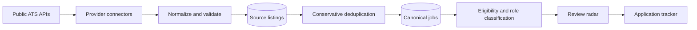

# JustWork

**A local-first job radar for Software Engineering opportunities in Portugal and Remote Europe/EMEA.**

JustWork turns fragmented career pages into a single, actionable queue. It collects vacancies directly from public Applicant Tracking Systems (ATS), keeps their history in PostgreSQL, removes duplicates conservatively, and explains whether each role appears accessible to someone based in Portugal.

The project was built to solve a real job-search problem: maximize discovery without spending every day checking the same company pages, while keeping the final application decision human.

> **Project status:** functional V1, designed for daily personal use. The current priority is a reliable, free workflow—not a feature-heavy recruitment platform.

## What it does

- Collects public vacancies from **Greenhouse, Lever (Global and Europe), and Ashby**.
- Normalizes different provider payloads into one consistent domain model.
- Persists collection history and updates listings idempotently.
- Deduplicates vacancies using source identity, canonical URLs, and conservative company/title/location matching.
- Classifies roles by family, remote policy, and eligibility for Portugal using deterministic, explainable rules.
- Keeps uncertain results visible for human review instead of silently discarding them.
- Provides a filterable radar to save, dismiss, restore, and inspect opportunities.
- Tracks applications from submission through screening, interview, offer, or rejection.
- Exposes source health, recent runs, failures, and protected collection controls.
- Supports unattended daily collection through Windows Task Scheduler.

## Why it is interesting

The central engineering trade-off is **high recall during discovery and high precision during review**.

JustWork deliberately avoids opaque scoring and premature infrastructure. Geographic eligibility is evidence-based, ambiguous matches are not merged, a single missing collection does not close a job, and personal decisions remain separate from the observed state of a vacancy. This makes the system easier to reason about, test, and evolve from real usage data.

## How it works



Each collection run is recorded independently. A failing source does not prevent the remaining sources from completing, and concurrent runs for the same source are blocked at the database level. Raw provider payloads are retained so normalization and classification rules can be improved without fetching the source again.

## Product areas

- **Radar:** searchable, paginated queue with filters for eligibility, role family, company, work model, freshness, source, vacancy status, and personal state.
- **Job details:** sanitized description, eligibility rationale, dates, source provenance, notes, and application form.
- **Applications:** lightweight pipeline for tracking the status of submitted applications.
- **Sources & health:** operational dashboard for source configuration, collection history, failures, and freshness.

## Tech stack

| Area | Technology |
| --- | --- |
| Application | Next.js 16, React 19, TypeScript 6 |
| Database | PostgreSQL 17 |
| Data access | Drizzle ORM and versioned SQL migrations |
| Validation and tests | Node.js test runner, fixture-based connector tests, PostgreSQL integration tests |
| Local infrastructure | Docker Compose |
| Scheduling | Windows Task Scheduler |

The V1 intentionally uses no paid services, queues, microservices, machine learning, embeddings, or vector database.

## Data model

The model separates three concerns that are often accidentally mixed:

1. **Provider observation** — `source_listings` stores the raw vacancy, content hash, first/last seen dates, and presence history.
2. **Canonical opportunity** — `jobs` represents the deduplicated role and its normalized classification.
3. **Personal workflow** — `job_actions` and `applications` store decisions and application progress without altering source truth.

Supporting tables (`companies`, `sources`, and `source_runs`) provide company identity, connector configuration, and operational observability.

## Getting started

### Prerequisites

- Node.js 20.9+
- npm
- Docker Desktop, or another PostgreSQL instance

### Installation

```bash
git clone https://github.com/thuliovs/justwork.git
cd justwork
npm install
```

Create the local environment file. On PowerShell:

```powershell
Copy-Item .env.example .env
```

Replace `ADMIN_TOKEN` with a long private value, then start the database and application:

```bash
docker compose up -d
npm run db:migrate
npm run db:seed
npm run dev
```

Open [http://localhost:3000](http://localhost:3000). The health endpoint at [http://localhost:3000/api/health](http://localhost:3000/api/health) also checks the PostgreSQL connection.

## Daily operation

Run all active sources sequentially:

```bash
npm run sources:collect
```

One source failure is isolated and recorded while the remaining sources continue. The process exits with a non-zero code if any run fails, is partial, or is skipped because another collection is active.

On Windows, a daily task can be installed for the current user without elevation:

```powershell
.\scripts\install-daily-task.ps1 -At "08:00"
```

The scheduler runs missed collections when the computer becomes available and prevents overlapping scheduled instances. PostgreSQL must be running at collection time.

## Useful commands

| Command | Purpose |
| --- | --- |
| `npm run dev` | Start the development server |
| `npm run build` | Create a production build |
| `npm run lint` | Run ESLint |
| `npm run typecheck` | Validate TypeScript types |
| `npm test` | Run unit, fixture, and PostgreSQL integration tests |
| `npm run db:migrate` | Apply pending database migrations |
| `npm run db:seed` | Add or update the initial source registry |
| `npm run db:studio` | Open Drizzle Studio |
| `npm run source:fetch` | List configured sources |
| `npm run source:fetch -- <source-id>` | Collect one source |
| `npm run sources:collect` | Collect every active source |
| `npm run jobs:backfill` | Link stored listings to canonical jobs |
| `npm run jobs:classify` | Reclassify stored jobs without network access |

Tests use local fixtures instead of calling external ATS APIs. Database integration cases create temporary records and clean them up after execution.

## Repository structure

```text
src/
  app/                 Next.js pages, actions, and health endpoint
  lib/
    connectors/        Greenhouse, Lever, and Ashby adapters
    db/                PostgreSQL schema, connection, and seed
    jobs/              Normalization, matching, eligibility, and classification
    radar/             Queries, filters, presentation, and personal actions
    sources/           Collection orchestration and source operations
  scripts/             Collection, backfill, and classification entry points
drizzle/               Versioned SQL migrations
scripts/               Windows scheduling helpers
test/                  Unit, fixture, and integration tests
```

## Current scope and roadmap

The current V1 covers structured ATS sources and the complete review-to-application workflow. Likely next steps, driven by actual usage, are:

- expand coverage to additional ATS providers and selected career pages;
- add recency and source-quality metrics;
- improve application-priority ranking with transparent rules;
- measure which sources contribute unique, eligible opportunities;
- add deployment only when local daily operation becomes a real constraint.

Fit scoring, semantic search, and heavier infrastructure remain intentionally out of scope until the collected data demonstrates a concrete need.
